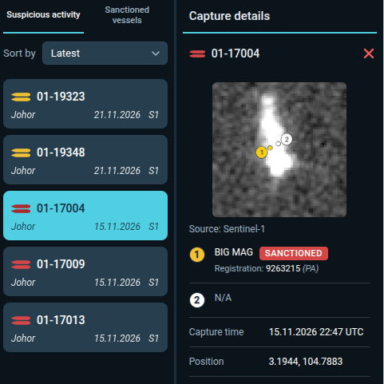
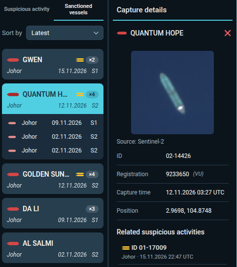
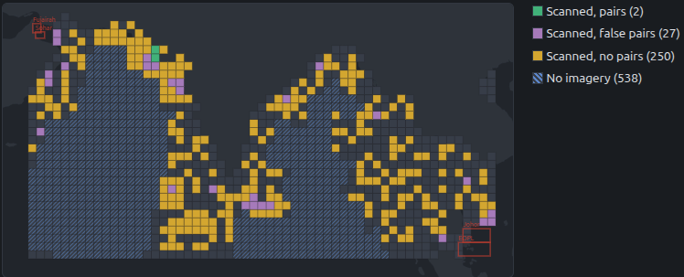
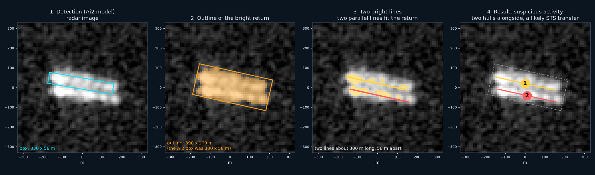
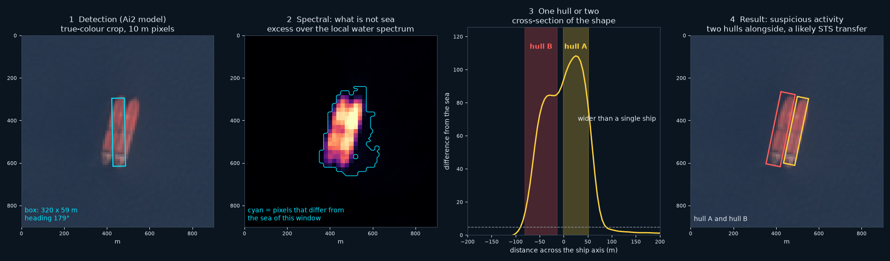

# Dark Petro

A public, read-only map of **suspected ship-to-ship (STS) oil transfers** found in free satellite imagery, and of
**sanctioned vessels** caught on camera at the same places. This repository is the overview of the whole process, from a
new satellite pass to a dot on the map, and it holds the part the public sees: the data build, the tile service and the web
viewer.

## What is Dark Petro

The aim is to track illegal activity that could involve sanctioned vessels. Ship-to-ship (STS) transfer, where two vessels
stop alongside each other at sea and move cargo across, is a questionable practice that helps countries get around sanctions
and other economic restrictions. STS is not the problem in itself; it is a hint that something suspicious may be taking
place, and we assume that vessels taking part in it are more likely to be sanctioned ones. The viewer has two tabs.

### Suspicious activity

Each entry is STS activity in a hot spot: two vessels lying alongside each other. The reel on the left lists what the map is
showing, and the panel next to it shows the satellite capture, the time, the hot spot and who the vessels are according to
AIS (name, flag, IMO), or that a hull had no AIS signal at all.

### Sanctioned vessels

A watch list: ships already on a sanctions list. We follow them and record every time one is seen in a hot spot, so their
behaviour can be checked, including whether they turn up in suspicious activity. A vessel appears once on the map with its
newest sighting; the panel lists every sighting and links to any suspicious activity it took part in.

## Applying geo-intelligence

### Why these hot spots

Findings are limited to a fixed set of **hot spots**: open-water areas where STS transfers are known to happen. We chose four
of them from open-source reporting (OSINT), articles about the phenomenon in each area, linked below, and checked them by
scanning other candidate areas with the same detectors so that the activity is really concentrated in these places. The
fifth, Sikka, came out of that scan itself, as described under the table. We can only detect what Sentinel-1 and Sentinel-2
cover.

| Hot spot | Area | Article |
|---|---|---|
| **Fujairah** | Off Fujairah and Khor Fakkan, Gulf of Oman | [Misbar tracks ship-to-ship transfers in Gulf of Oman using satellite imagery](https://www.misbar.com/en/editorial/2026/08/29/misbar-tracks-ship-ship-transfers-gulf-oman-using-satellite-imagery) |
| **Sohar** | Off Sohar, Gulf of Oman | [Eye in the sky: European satellite catches 19 shadow energy transfers off Oman coast in one day](https://gulfnews.com/business/energy/eye-in-the-sky-european-satellite-catches-19-shadow-energy-transfers-off-oman-coast-in-one-day-1.500698428) |
| **EOPL** | East of Singapore Strait (EOPL) | [In the waters off Malaysia, Iranian oil sales continue despite blockade](https://aljazeera.com/news/2026/7/30/in-the-waters-off-malaysia-iranian-oil-sales-continue-despite-blockade) |
| **Johor** | East of Johor, South China Sea | [MMEA special action team conducts forced boarding by helicopter of two errant vessels in eastern Johor waters](https://www.malaymail.com/news/malaysia/2023/10/24/mmea-special-action-team-conducts-forced-boarding-by-helicopter-of-two-errant-vessels-in-eastern-johor-waters/98134) |
| **Sikka** | Gulf of Kutch, off Sikka and Vadinar | Found by our own scan, see [below](#sikka-how-we-found-a-new-hot-spot) |

### Sikka: how we found a new hot spot

To look for new hot spots we scan the open sea between the known ones with the same detectors. The sea is cut into squares
about the size of one satellite scene, squares are drawn at random and scanned on two dates, and the squares around any
confirmed pair are scanned too, to see whether the activity continues. A new area qualifies when its confirmed pairs per
scanned scene are in line with the existing hot spots.

The red outlines are the existing hot spots. The two green squares, in the Gulf of Kutch off India's west coast, are Sikka
and Vadinar: the only places where the scan confirmed pairs. They became the fifth hot spot in November 2026.

### How we detect STS activity

In a satellite image, STS activity shows as two hulls lying side by side. Every ship in a hot-spot image has to be found, and
then we tell whether it is one hull or two. The examples below are real passes over Sohar.

**Finding the ship (Ai2).** Open, pre-trained ship detectors from the Allen Institute for AI, one per sensor, mark each ship
with a box: position, length, width and heading. A box describes one object, so two ships side by side usually get a single
box (cyan in the images below).

**One hull or two.** This is our own check, and it differs by sensor:

- **Sentinel-1 (radar), geometry.** A metal hull is a bright return. We outline the bright area and look for two parallel
  bright lines of ship length; two lines in a tanker-sized outline mean two hulls.
- **Sentinel-2 (optical), spectral.** Each pixel is compared with the colour of the surrounding sea. The pixels that are not
  sea show the shape of the hulls, and if that shape is wider than one ship and has a second hull beside the first, it is
  STS activity.

**Sentinel-1**

1. The detector draws one box over part of the bright return.
2. The outline of the whole return is much larger than the box.
3. Two parallel bright lines fit the return: two hulls.
4. The finding is suspicious activity, with a numbered marker on each hull.

**Sentinel-2**

1. The detector draws one box, covering only one of the hulls.
2. The spectral map shows everything that is not sea: one shape, wider than a single ship.
3. A cross-section of that shape has two shoulders, hull A (the one in the box) and hull B beside it.
4. Both hulls are outlined and the finding is suspicious activity.

Each hull is then matched to the AIS archive, so it becomes a named vessel or a vessel with no AIS signal. A ship that is on a
sanctions list is recorded as a sanctioned vessel.

## The architecture

### The logical pipeline

<picture>
  <source media="(prefers-color-scheme: dark)" srcset="docs/img/pipeline-dark.svg">
  
</picture>

1. **Watch.** Every few hours we check the public Sentinel catalogues for new passes over each hot spot. Each one becomes a
   job.
2. **Download and tile.** The satellite scene is downloaded and cut into small image tiles that the detector can read.
3. **Detect.** Ships are found and each one is checked for a second hull alongside it, as described above.
4. **Add AIS.** Each hull is matched to the AIS archive and checked against the sanctions lists.
5. **Publish.** The findings are saved and prepared for viewing, and the web viewer rebuilds the data it shows whenever they
   change.

### Infrastructure components

<picture>
  <source media="(prefers-color-scheme: dark)" srcset="docs/img/architecture-overview-dark.svg">
  
</picture>

The control host sends each job to the prep worker, which hands over to the GPU worker; the workers run only when there are
jobs. Everything that is kept lives in the shared cloud storage (S3), which belongs to no machine; the workers use their own
disks only as scratch space.
