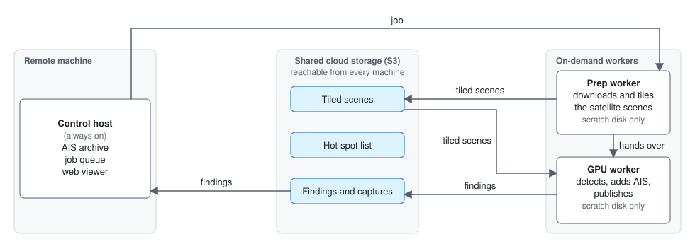

# Dark Petro

Dark Petro is an open-source intelligence (OSINT) viewer for suspected ship-to-ship (STS) oil transfers, where oil is pumped
between two vessels in open sea. Its aim is to track illegal activity that could involve sanctioned vessels, so it also records
every time a sanctioned vessel is seen in the same areas.

Dark-fleet trackers mostly follow vessels through AIS, the position signal that ships broadcast, and some back their STS alerts
with satellite imagery, but as commercial services. Dark Petro starts from the transfer itself: it finds suspected transfers in
public satellite imagery over defined areas of open sea and publishes each one, with its capture, for free.

**Live viewer: [darkpetro.stamsite.cc](https://darkpetro.stamsite.cc/)**

## Suspicious activity

Moving cargo between ships at sea helps countries get around sanctions and other economic restrictions. It is not a problem
in itself, but it is a hint that something suspicious may be taking place, and we assume that vessels taking part in it are
more likely to be sanctioned ones.

Each entry is a pair of vessels lying alongside each other in a hot spot. The list on the left follows the map, and the panel
next to it shows the satellite capture, the time, the hot spot and each vessel's name, flag and IMO number (the permanent
number every ship carries) according to AIS, or that a vessel sent no AIS signal at all. We find the pairs in the satellite
images with ship detectors and our own check for a second ship (see [How we detect STS activity](#how-we-detect-sts-activity)),
and match each vessel to the archive of AIS signals.

## Sanctioned vessels

A watch list of ships that are on a sanctions list, matched by their IMO number. We follow them and record every time one is
seen in a hot spot, so their behaviour can be checked, including whether they turn up in suspicious activity.

A vessel appears once on the map, at its newest sighting. The panel shows the capture and lists every sighting, with links to
any suspicious activity it took part in. We find these vessels in the same satellite images: a single ship whose AIS signal
identifies it as a sanctioned vessel is recorded as a sighting.

## Lighting the darkness

Illicit ship-to-ship transfers often happen between dark vessels: ships that switch off their AIS transponder and vanish from
tracking services. With no track to follow, one of the few ways left to find them is to look for the vessels themselves, using
other methods.

This section explains how we process satellite imagery and geo-intelligence data to light up that darkness and identify
suspected STS activity.

### Why we look at hot spots

The open sea is far too big to search everywhere: every satellite image has to be downloaded, processed and checked. Transfers
are not spread evenly, though. They gather in a few stretches of water, close to busy ports and shipping lanes, which we call
hot spots. Looking only there finds far more for the same effort: in our first scan of random squares of sea, about 1 image in
50 held a confirmed pair, while the images of the hot spots held between one and six.

We chose four of the hot spots from open-source reporting (OSINT), the news articles linked below, and checked them by
scanning other areas with the same detectors, to make sure the activity is really concentrated in these places. The fifth,
Sikka, came out of that scan itself, as described under the table. We can only detect what the Sentinel satellites cover.

| Hot spot | Area | Article |
|---|---|---|
| **Fujairah** | Off Fujairah and Khor Fakkan, Gulf of Oman | [Misbar tracks ship-to-ship transfers in Gulf of Oman using satellite imagery](https://www.misbar.com/en/editorial/2026/08/29/misbar-tracks-ship-ship-transfers-gulf-oman-using-satellite-imagery) |
| **Sohar** | Off Sohar, Gulf of Oman | [Eye in the sky: European satellite catches 19 shadow energy transfers off Oman coast in one day](https://gulfnews.com/business/energy/eye-in-the-sky-european-satellite-catches-19-shadow-energy-transfers-off-oman-coast-in-one-day-1.500698428) |
| **EOPL** | East of Singapore Strait (EOPL) | [In the waters off Malaysia, Iranian oil sales continue despite blockade](https://aljazeera.com/news/2026/7/30/in-the-waters-off-malaysia-iranian-oil-sales-continue-despite-blockade) |
| **Johor** | East of Johor, South China Sea | [MMEA special action team conducts forced boarding by helicopter of two errant vessels in eastern Johor waters](https://www.malaymail.com/news/malaysia/2023/10/24/mmea-special-action-team-conducts-forced-boarding-by-helicopter-of-two-errant-vessels-in-eastern-johor-waters/98134) |
| **Sikka** | Gulf of Kutch, off Sikka and Vadinar | Found by our own scan, see [below](#sikka-how-we-found-a-new-hot-spot) |

### Sikka: how we found a new hot spot

To look for new hot spots, we scan the open sea between the known ones. The sea is divided into squares, each about the size
of one satellite image, and a random sample of them is checked on two dates. Where a square turns up pairs that a reviewer
confirms, we check it and its neighbours on more dates, to see whether the activity keeps happening and where exactly it is
concentrated. An area becomes a hot spot when it has about as many confirmed pairs per image as the hot spots we already have.

The red outlines are the existing hot spots. The two green squares, in the Gulf of Kutch off India's west coast, cover Sikka
and Vadinar. They were the only squares in the scan with pairs confirmed by a reviewer, and the area became the fifth hot spot.

### How we detect STS activity

In a satellite image, STS activity looks like two ships lying side by side. We first find every ship in the image of a hot
spot, then decide whether each one is a single ship or two lying together. The examples below are real passes over Sohar.

**Finding the ship (Ai2).** Open, pre-trained ship detectors from the Allen Institute for AI, one for each satellite, mark each
ship with a box that gives its position, length, width and heading. A box describes one object, so two ships side by side
usually get a single box (cyan in the images below).

**One ship or two.** This is our own check, and it works differently for each satellite:

- **Sentinel-1 (radar).** Radar shows the metal body of a ship (its hull) as a bright area. We outline the bright area and
  look for two parallel bright lines of ship length; two lines inside an outline the size of a tanker mean two ships.
- **Sentinel-2 (optical).** Each pixel is compared with the colour of the surrounding sea. The pixels that are not sea show the
  shape of the ships, and if that shape is wider than one ship and has a second ship beside the first, it is STS activity.

**Sentinel-1**

1. The detector draws one box over part of the bright area.
2. The outline of the whole bright area is much larger than the box.
3. Two parallel bright lines fit the area: two ships.
4. The result is suspicious activity, with a numbered marker on each ship.

**Sentinel-2**

1. The detector draws one box, covering only one of the ships.
2. The spectral map, which compares every pixel with the sea, shows everything that is not sea: one shape, wider than a single
   ship.
3. A cross-section of that shape has two shoulders: hull A (the one in the box) and hull B beside it.
4. Both ships are outlined and the result is suspicious activity.

Each ship is then matched to the archive of AIS signals, so it becomes a named vessel or a vessel with no AIS signal. A ship
that is on a sanctions list is recorded as a sanctioned vessel.

## The architecture

### The logical pipeline

<picture>
  <source media="(prefers-color-scheme: dark)" srcset="docs/img/pipeline-dark.svg">
  
</picture>

1. **Watch.** Every few hours we check the public Sentinel catalogues for new passes over each hot spot. Each one becomes a
   job.
2. **Download and tile.** The satellite scene is downloaded and cut into small image tiles that the detector can read.
3. **Detect.** Ships are found and each one is checked for a second ship alongside it, as described above.
4. **Add AIS.** Each ship is matched to the archive of AIS signals and checked against the sanctions lists.
5. **Publish.** The findings are saved and prepared for viewing, and the web viewer rebuilds the data it shows whenever they
   change.

### Infrastructure components

<picture>
  <source media="(prefers-color-scheme: dark)" srcset="docs/img/architecture-overview-dark.svg">
  
</picture>

The control host sends each job to the prep worker, which hands over to the GPU worker; the workers run only when there are
jobs. Everything that is kept lives in the shared cloud storage (S3), which belongs to no machine; the workers use their own
disks only for temporary working files.
